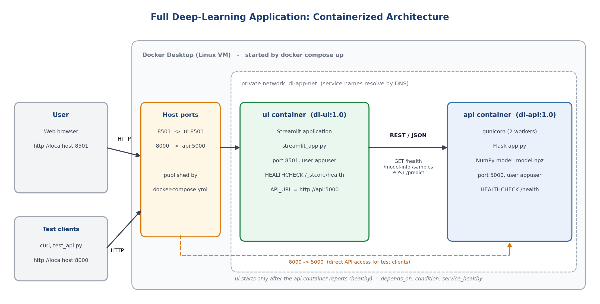

# Full Application Containerization

Containerizes the complete deep-learning solution: the **model**, the **Flask API** and the **Streamlit UI**, started together with Docker Compose.

## Objective

To containerize the complete deep learning solution including model, Flask API, and Streamlit UI.

## Architecture



| Container | Image | Contents | Port |
|-----------|-------|----------|------|
| `api` | `dl-api:1.0` | Flask + gunicorn, NumPy model (`model.npz`) | 5000 (host 8000) |
| `ui` | `dl-ui:1.0` | Streamlit application, calls the API | 8501 (host 8501) |

The UI contains no model: it calls the API over a private Compose network (`dl-app-net`) using the service name `api` (`API_URL=http://api:5000`). `docker-compose.yml` starts the UI only after the API container reports *healthy*. Both images are multi-stage builds that run as a non-root user and have a `HEALTHCHECK`.

## Approach

1. **Package all application components** - model + API in one image, UI in another; one Compose file ties them together
2. **Configure dependencies** - separate pinned `requirements.txt` for `api/` and `ui/`; training-only code stays out of the images
3. **Build Docker images** - `docker compose build` (slim base, multi-stage, no pip cache, `.dockerignore`)
4. **Perform testing** - API test suite, UI integration test (Streamlit AppTest inside the `ui` container against the real API), health and resilience checks
5. **Document architecture** - diagram above, this README, the testing report (PDF)

## Files

```
.
├── docker-compose.yml          # both services, network, health-based start order
├── architecture.png            # architecture diagram
├── api/
│   ├── app.py                  # Flask API (/health, /model-info, /samples, POST /predict)
│   ├── train_model.py          # trains the NumPy model (not part of the image)
│   ├── model/model.npz         # trained weights, metadata, sample images
│   ├── requirements.txt
│   ├── Dockerfile
│   └── .dockerignore
├── ui/
│   ├── streamlit_app.py        # Streamlit user interface
│   ├── requirements.txt
│   ├── Dockerfile
│   └── .dockerignore
├── tests/
│   ├── test_api.py             # 13 black-box API checks (run on the host)
│   └── ui_apptest.py           # 8 UI integration checks (run inside the ui container)
├── task11_docker.py            # runs the whole Docker workflow and logs the real output
├── local_verification.txt      # test output from a local run (outside Docker)
└── README.md
```

## How to run

Requirements: Docker Desktop running (*Engine running*), Python 3, internet access, a bash-compatible terminal. Host ports **8000** and **8501** must be free.

```bash
docker compose up -d --build
```

Open the UI at **http://localhost:8501** and the API at **http://localhost:8000/health**. Stop everything with `docker compose down`.

Everything in one go, with logs for the report:

```bash
python3 task11_docker.py
```

Run the tests by hand:

```bash
python3 tests/test_api.py --url http://localhost:8000
docker compose exec -T ui python - < tests/ui_apptest.py
```

## Local verification (outside Docker)

Before containerizing, API (gunicorn) and UI (Streamlit) were run from clean virtual environments with the pinned dependencies: **13/13 API checks** and **8/8 UI integration checks** passed (10/10 sample digits classified correctly through the UI; invalid input and an API outage are handled without crashing), and the Streamlit server answered `/_stcore/health` with `ok`. See `local_verification.txt`. The Docker build and run results are recorded by `task11_docker.py` on the machine that runs Docker.
